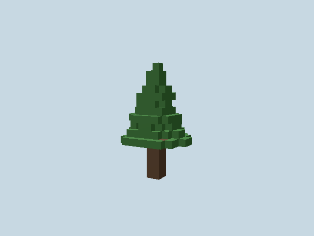
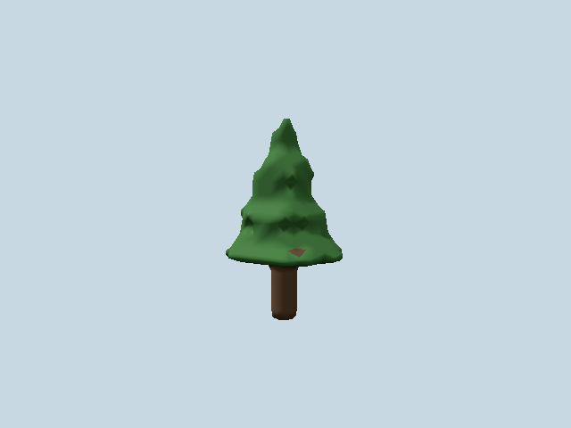
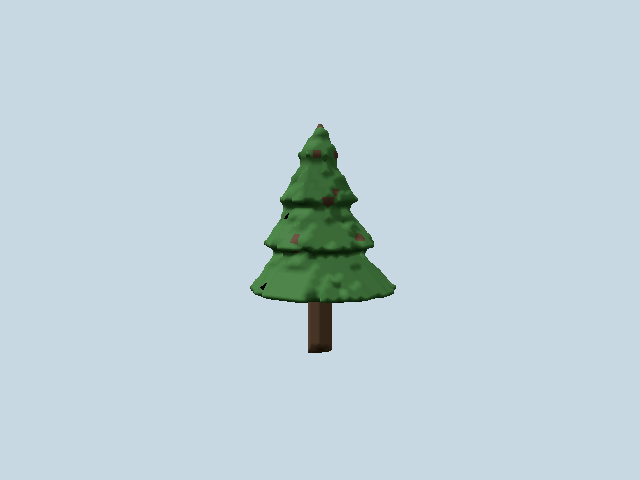
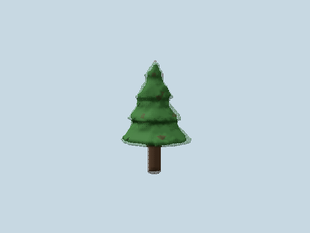
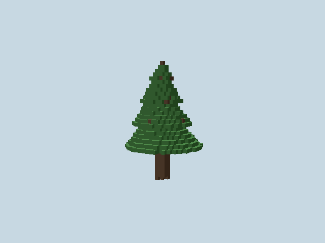
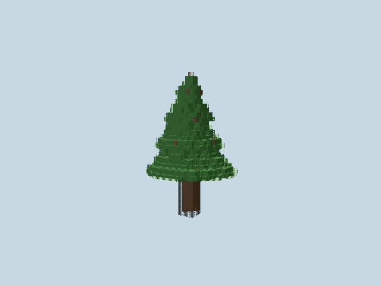
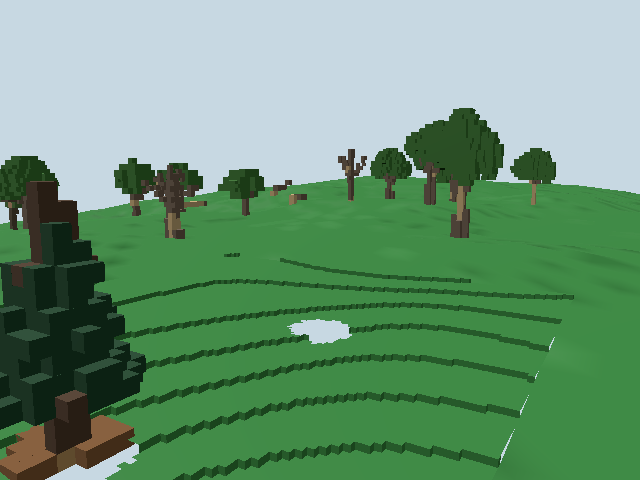
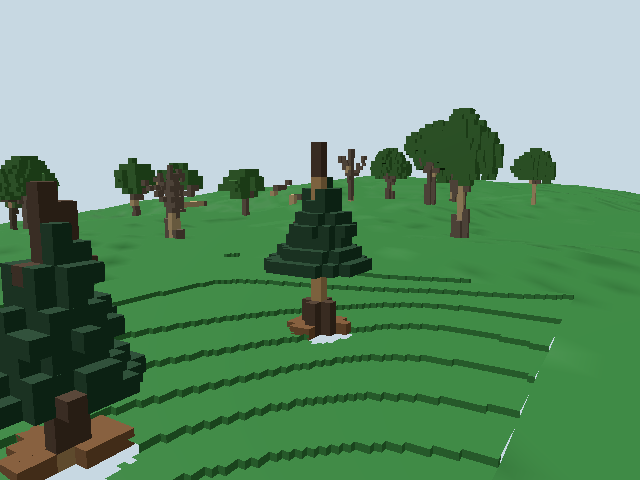
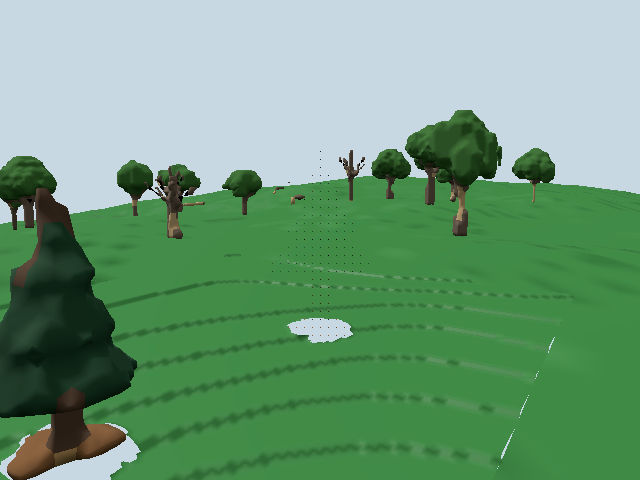
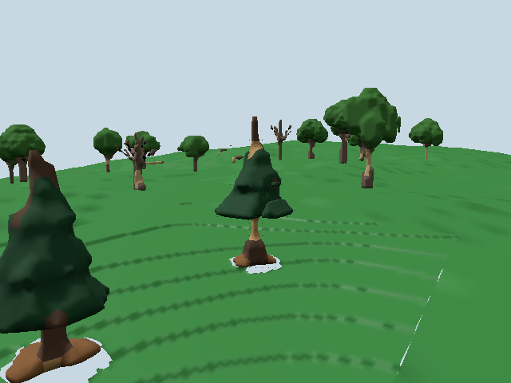

# Phase E2 — Vegetation LOD continuity

## A. Root causes

The previous implementation had three distinct discontinuities:

1. **Shape:** `vegetationCells` sampled each coarse cell at its center, with a special case for the unleaned trunk axis. Thin off-center structure could disappear. One-meter cells also shifted the apparent axis and canopy envelope. Polygonal near trees used Surface Nets while both distant modes used boxes.
2. **Readiness:** detailed vegetation shared terrain chunk generation. A tree could span multiple horizontal/vertical chunks, and upper/lower or near/far sections finished separately. Predictive regional proxies did not make complete detailed trees ready. Proximity alone cannot make expensive preparation instantaneous.
3. **Handoff:** `Runtime.sync()` immediately hid each proxy cell as its chunk became resident. Intermediate regional geometry was also replaced in one commit. There was no temporal transition; a stationary player could receive a late, single-frame change or disconnected partial changes.

Resumed E2 review also reproduced a visibility-cache defect: ownership could return to the proxy after invalidation without a loaded-map revision. Cached proxy masks and detailed material stages then stayed stale, leaving a chunk-spanning tree incomplete during recovery. The new coverage revision fixes this independent of chunk-map membership.

The correction addresses these separately. It does not move trees or change their authoritative placement, seed, source elevation or collision to hide the issue.

## B. Identity and representation

All levels use the existing feature descriptor, stable ID, species, origin, seed, variant and sampling closure. Provider algorithms and biome distributions are unchanged. There is no additional procedural tree generator, saved feature inventory or serialized animation progress.

`VegetationLOD/Ownership.mjs` holds bounded runtime records keyed by feature ID. Proxy-region and detailed-mesh references share a texture slot, including when a canopy crosses region boundaries. References are released on eviction and mesh disposal. At most 4,095 tracked identities fit the fixed 4,096-slot RGBA texture; slot zero is reserved for unowned geometry. Exhaustion increments diagnostics rather than growing a world-sized table. Source descriptors remain in the existing bounded feature caches.

## C. Voxel LOD

`Sampling.mjs` retains the original globally aligned center/axis occupancy sampling at 0.5 m and 1 m. An experimental corner-aggregation approach preserved more twigs but painted canopy cells with wood, fragmented greedy box runs, and materially regressed rendering. It was discarded rather than accepted as an identity improvement.

`Trunks.mjs` instead samples a bounded cross-section around the authoritative upright trunk axis near the ground. It builds a compact source-derived base envelope, clips ground contact and region boundaries, and merges compatible vertical segments. Unsupported/wide/discontinuous or fallen cases retain their previous shapes. `Boxes.mjs` accepts those explicit envelopes without disturbing the existing greedy path. The underlying occupancy, descriptor and polygonal source cells stay unchanged; this does not generate detailed trees farther away.

The controlled pine's one-meter voxel base-axis offset improves from 0.5 m to approximately 0.18 m relative to the descriptor origin (the actual occupied voxel centers have a half-voxel offset). Its intermediate voxel silhouette is unchanged. Fine branches can still disappear at coarse resolution; controlled transitions address the visible refinement rather than inflating every branch into a meter-scale block. Performance and retained shape fidelity take priority over exhaustive far-field twig coverage.

## D. Polygonal LOD

`Polygonal.mjs` extracts the coarse feature occupancy with the same Surface Nets algorithm used for detailed polygonal trees. It removes internal box faces and produces coherent connected coarse surfaces, rather than a cube-to-organic style change. Only occupied coarse chunks are prepared; work yields cooperatively. Positions derive from the same aligned sampled source and authoritative feature parameters.

Geometry is combined by region/material using existing color batching, with one scene mesh per region rather than a hierarchy per tree. `FeatureCulling.mjs` conservatively culls authoritative feature envelopes; stationary matrix revisions and unchanged selections skip scans/index rewrites. Canonical material identity/colors remain authoritative. Temporary extraction arrays are released after installation. This does not add an independent detailed-vegetation world or keep a second full-resolution tree beneath each proxy.

Voxel proxies retain shared boxes, material batching, visible-instance compaction and audited E1 frustum filtering. Stable proxy batches use their original opaque materials; only active fades select the owned dither shader. Detailed sections also return to original materials after completion, and fully proxy-owned procedural material sections can skip rendering while remaining available to collision/picking. Mixed/ambiguous sections can retain the coverage shader while incomplete; renderer totals include that cost. Extra-transition draw counters report outgoing regional draws; incoming detailed groups remain part of ordinary renderer totals. The shader-mesh audit refers to proxy batches. The custom transition shader is explicitly allowed through that filter; unrelated customized materials retain its conservative fallback.

## E. Transition system

**Complete detailed feature readiness:** every chunk intersecting a feature's authoritative bounds must be resident, visible and uninvalidated, or explicitly known empty from its column-level query. The loaded-map, invalidation and column-level revisions cache readiness checks. A separate coverage revision changes at proxy-only, fading and detailed ownership boundaries. Both detailed material selection and proxy masks observe it. Intermediate fade values update only the texture, avoiding repeated material/instance scans during an otherwise unchanged fade. Same-ID source-bound changes refresh the footprint and cancel stale readiness before a new handoff. Up to 128 intersecting chunk keys are supported per feature; larger/incomplete footprints remain proxy-owned and are reported, rather than forcing unlimited residency.

`Detail.mjs` attributes procedural vegetation vertices inside the existing merged chunk meshes to descriptor slots. Ground indices, positions, normals, UVs and canonical groups remain unchanged. Only procedural chunk construction invokes this adapter. Existing authored/imported object meshes are not processed. Unowned vertices remain fully visible. Collision and picking continue to use the authoritative composed mesh/voxel pipeline.

When a proxy-owned tree becomes completely ready, a **350 ms opaque ordered-dither transition** starts. At most **eight detailed feature upgrades** run simultaneously; waiting trees are ordered by proximity and age. The outgoing proxy remains until completion. Every attributed detailed section shares the same progress, so late completion beside a stationary player fades the whole logical tree rather than exposing chunks independently. Critical collision does not wait for this visual animation.

The first experimental world-position hash produced coverage holes because near and coarse surfaces occupied different positions. Retained production shaders instead use the same deterministic **8 × 8 screen-door threshold** at each framebuffer pixel. The masks are complementary where silhouettes overlap, do not reseed over time, preserve depth writing, and require no alpha blending or tree scaling. The stipple is visible during a close inspection; it is not a morph between different silhouettes. A moving camera sees a screen-anchored ordered pattern rather than a randomized temporal shimmer.

Regional LOD and voxel/polygonal proxy changes also use a 350 ms transition, with at most **four outgoing regions** and **2 MiB estimated outgoing buffers**, in addition to the existing **8 MiB installed proxy budget / 64-region limit**. A region cannot restart while its current transition is active. Incoming/outgoing geometry is disposed after completion or eviction. Two fully opaque copies are never deliberately retained through the animation. Budgeted estimates describe CPU/typed geometry buffers, not driver allocation guarantees.

`Priority.mjs` reorders only existing detailed queue entries for up to four nearby incomplete features, with motion-corridor preference. It does not enlarge the detailed radius, add unbounded columns, interrupt pending collision work or let distant refinements acquire a separate terrain budget. This reduces avoidable scheduling delay but cannot guarantee advance readiness during arbitrary fast travel.

Disabling distant vegetation restores the original detailed materials and removes the ownership attribute, avoiding a permanent dither cost in that control case. Enabling it attributes resident chunks once. Runtime style changes retain existing proxy coverage until the requested representation is prepared.

## F. Actual visual evidence

[Open the rendered sequence gallery](TerrainE2Visuals/index.html), with 72 real WebGL images: the same pine in both modes, previous/current implementations, three distances and fifteen delayed-transition times. [Raw pixel metrics](TerrainE2VisualMetrics.json) identify the descriptor, eight intersecting chunks (four drawable), coverage and every sampled frame. Camera, source, materials and lighting match within each comparison.

A camera-facing chunk becomes visible at 60 ms; all chunks are ready at 200 ms. The camera then stays beside the tree while the controlled upgrade runs. Test time is stepped deliberately to reproduce the readiness event; these images are not FPS measurements.

| Mode | Peak sampled silhouette change, previous → current | Initial proxy / final detail silhouette IoU | Partial-install pixel change, current |
|---|---:|---:|---:|
| voxel | 11.60% → 1.58% | 0.878 → 0.878 | 0.0000 |
| polygonal | 14.30% → 2.07% | 0.856 → 0.853 | 0.0000 |

Peak change is silhouette XOR divided by silhouette union between consecutive sampled frames, not a universal per-frame popping score. The 40 ms transition samples approximate several display frames. Modified partial installation produces no pixel change for this fixture; progress remains zero until the whole feature is ready. Both final detailed PNGs are byte-identical to their previous-system references. This demonstrates a controlled late upgrade rather than claiming every streaming event is seamless.

| Render | Previous | Current |
|---|---|---|
| Polygonal near proxy |  |  |
| Late polygonal upgrade, 360 ms |  |  |
| Late voxel upgrade, 360 ms |  |  |

Distances, trunk-axis offsets, source bounds and silhouette differences are retained separately. The source-derived trunk envelope corrected this pine's measured trunk-axis offset from 0.5 m to approximately 0.18 m in voxel mode. Polygonal coarse geometry retains its grid approximation. Source occupancy is unchanged; the bounded trunk envelope's additional boxes are included in the workload tables. Full voxel and polygonal near geometry remains unchanged.

The visual fixture isolates a deterministic source tree and uses production coarse extraction, chunk mesh construction, attribution and shaders. The actual GameView Editor/Viewer and streaming benchmark exercise integration separately. Pixel-perfect final identity does not mean approximate proxy silhouettes match exactly during the transition.

### Resumed invalidation/recovery evidence

[Eight new actual-runtime WebGL cases](TerrainE2ResumeResults.json) compare the recorded pre-resume E2 code against the coverage-cache correction, in both modes and two reversed orders. The source, tree, camera and chunk-map membership remain fixed. One resident section is explicitly invalidated and hidden to reproduce incomplete detail, then restored. This isolates visibility recovery; it does not claim that normal camera movement or all source edits follow this artificial timeline.

| Recovery frame | Previous E2 cache | Corrected coverage cache |
|---|---|---|
| Voxel |  |  |
| Polygonal |  |  |

The old code leaves the target proxy masked during invalidation **and** the subsequent partial fade, producing visibly missing tree sections. The correction restores the complete proxy immediately and keeps it through intermediate recovery coverage, then returns to detailed-only rendering. All four corrected cases traverse intermediate values before completion; no seed, geometry extraction, collision or saved source is changed. Sixteen PNG captures retain ready, invalidated, recovering and restored stages. The hidden whole chunk also removes its ground in this diagnostic fixture; that artificial ground hole is outside this vegetation correction. Recovery images can fall at different real frame times, so pixel differences are retained without presenting them as a synchronized silhouette score.

## G. Performance

The [36-case production matrix](TerrainE2Performance.json) compares the recorded pre-E2 system, including E3, against E2 in both modes. Horizontal worlds: 50 × 50 m, 1,000 × 2,000 m, infinite signed procedural, a deterministically selected dense forest, the saved Mount Pelion geographic crop, and procedural terrain with a graded path and construction cut. Procedural vertical extent is 128 m; geographic extent/source metadata are retained. Large-world disabled-layer controls are included. Large/infinite enabled cases have two reversed-order pairs; other cases have one pair.

Chromium uses **SwiftShader at 640 × 480, pixel ratio 1, antialiasing off**. Each case settles queues, warms for 60 frames, then measures stationary (180 frames), walking/running/fast/backtracking/turning/teleport (60 each), and stopped-late (180). Movement is fixed per frame, not a claim of actual player speed. The stopped-late phase pauses new detail for 30 frames while proxies prepare. Infinite teleport moves 10 km, and source descriptors are re-queried afterward. Actual GameView interaction/collision is tested separately.

**Stationary frame times, original → E2 (ms):**

| World / mode / layers / trial | Mean | p95 | p99 | Draw calls | Triangles |
|---|---:|---:|---:|---:|---:|
| small / polygonal / on / 1 | 16.64 → 16.64 | 17.00 → 17.00 | 17.20 → 17.20 | 11 → 11 | 17344 → 17344 |
| small / voxel / on / 1 | 16.56 → 16.58 | 17.00 → 17.10 | 17.20 → 17.30 | 11 → 11 | 17344 → 17344 |
| large / polygonal / off / 1 | 16.65 → 16.63 | 17.00 → 17.10 | 17.40 → 17.20 | 10 → 10 | 15270 → 15270 |
| large / polygonal / on / 1 | 21.94 → 23.73 | 24.20 → 25.90 | 25.70 → 27.50 | 73 → 77 | 48998 → 52394 |
| large / polygonal / on / 2 | 29.79 → 23.55 | 32.50 → 25.50 | 35.00 → 27.30 | 73 → 77 | 48998 → 52394 |
| large / voxel / off / 1 | 16.58 → 16.61 | 17.00 → 17.10 | 17.10 → 17.30 | 10 → 10 | 15270 → 15270 |
| large / voxel / on / 1 | 22.61 → 30.80 | 25.80 → 34.80 | 28.20 → 38.10 | 73 → 71 | 48998 → 49502 |
| large / voxel / on / 2 | 30.13 → 30.21 | 33.70 → 32.70 | 36.70 → 34.10 | 73 → 71 | 48998 → 49502 |
| infinite / polygonal / on / 1 | 28.94 → 23.79 | 31.90 → 27.90 | 34.00 → 30.00 | 65 → 65 | 47474 → 48630 |
| infinite / polygonal / on / 2 | 28.93 → 23.82 | 33.10 → 27.90 | 34.90 → 29.20 | 65 → 65 | 47474 → 48630 |
| infinite / voxel / on / 1 | 28.91 → 29.06 | 31.90 → 32.30 | 33.60 → 34.40 | 65 → 63 | 47474 → 47654 |
| infinite / voxel / on / 2 | 28.78 → 29.18 | 31.90 → 32.30 | 33.30 → 35.40 | 65 → 63 | 47474 → 47654 |
| dense / polygonal / on / 1 | 48.66 → 30.87 | 53.70 → 35.60 | 58.80 → 36.80 | 100 → 98 | 79446 → 80494 |
| dense / voxel / on / 1 | 48.90 → 50.07 | 53.50 → 54.20 | 55.30 → 70.70 | 99 → 97 | 78906 → 76130 |
| geographic / polygonal / on / 1 | 22.25 → 20.15 | 24.60 → 22.60 | 26.60 → 23.00 | 39 → 41 | 45506 → 46082 |
| geographic / voxel / on / 1 | 22.71 → 22.95 | 25.90 → 24.90 | 26.70 → 25.80 | 38 → 35 | 42960 → 43164 |
| authored / polygonal / on / 1 | 30.68 → 24.01 | 35.30 → 26.70 | 37.90 → 29.30 | 74 → 78 | 51098 → 54494 |
| authored / voxel / on / 1 | 30.74 → 30.98 | 33.50 → 33.90 | 36.40 → 35.70 | 74 → 72 | 51098 → 51602 |

The final workload does not show a universal FPS improvement. Infinite/dense/authored polygonal cases improve in these software runs; voxel results are mostly close after warmup. The first large-voxel pair is substantially slower for E2, so it is retained explicitly. Its reverse-order pair is effectively level. Do not interpret a single cold-to-warm comparison as a proven hardware regression or dismiss it without a control.

**Same-scene control:** [six isolation trials](TerrainE2Isolation.json) hold terrain, camera and lighting fixed and swap the two proxy systems. Original means were 21.80 and 29.55 ms; E2 means were 22.11 and 30.42 ms, about 1–3% slower within each pair. The original itself drifted about 35% between trials. Sharing the old box GPU buffers gave 22.07 / 26.45 ms and no consistent advantage across both orders. Audits confirmed zero dither proxy materials in stable scenes. This demonstrates substantial time-dependent software-backend variability, not a hardware FPS guarantee.

The discarded corner-resampling attempts increased visible boxes from 801 to roughly 1,300 in the large voxel case and produced material slowdowns. The final source-derived trunk envelopes use 848 boxes, with 49,502 versus 48,998 submitted stationary triangles in that case, and 71 versus 73 draw calls. No extra full-resolution tree world was kept to obtain the result.

**Preparation and memory, original → E2:**

| World / mode / layers / trial | Settled preparation ms | Stationary update mean ms | Installed proxy estimate KiB | E2 proxy GPU-buffer capacity KiB |
|---|---:|---:|---:|---:|
| small / polygonal / on / 1 | 451 → 462 | 0.074 → 0.134 | 0.0 → 0.0 | 0.0 |
| small / voxel / on / 1 | 580 → 408 | 0.093 → 0.152 | 0.0 → 0.0 | 0.0 |
| large / polygonal / off / 1 | 484 → 419 | 0.056 → 0.115 | 0.0 → 0.0 | 0.0 |
| large / polygonal / on / 1 | 623 → 1688 | 0.043 → 0.104 | 172.6 → 549.8 | 374.4 |
| large / polygonal / on / 2 | 717 → 1505 | 0.051 → 0.101 | 172.6 → 549.8 | 374.4 |
| large / voxel / off / 1 | 203 → 164 | 0.046 → 0.086 | 0.0 → 0.0 | 0.0 |
| large / voxel / on / 1 | 526 → 878 | 0.031 → 0.104 | 172.6 → 172.6 | 96.7 |
| large / voxel / on / 2 | 632 → 876 | 0.034 → 0.090 | 172.6 → 172.6 | 96.7 |
| infinite / polygonal / on / 1 | 1112 → 3770 | 0.041 → 0.137 | 430.2 → 1415.1 | 841.7 |
| infinite / polygonal / on / 2 | 1180 → 3662 | 0.046 → 0.144 | 430.2 → 1415.1 | 841.7 |
| infinite / voxel / on / 1 | 1026 → 2008 | 0.039 → 0.155 | 430.2 → 430.2 | 260.6 |
| infinite / voxel / on / 2 | 1014 → 1958 | 0.051 → 0.167 | 430.2 → 430.2 | 260.6 |
| dense / polygonal / on / 1 | 1114 → 4658 | 0.057 → 0.148 | 1056.8 → 3003.5 | 1733.2 |
| dense / voxel / on / 1 | 1044 → 1959 | 0.046 → 0.154 | 1056.8 → 1056.8 | 426.2 |
| geographic / polygonal / on / 1 | 1568 → 1948 | 0.045 → 0.087 | 43.6 → 156.4 | 112.8 |
| geographic / voxel / on / 1 | 1502 → 1535 | 0.039 → 0.104 | 43.6 → 43.6 | 32.7 |
| authored / polygonal / on / 1 | 4929 → 5342 | 0.042 → 0.101 | 172.6 → 549.8 | 374.4 |
| authored / voxel / on / 1 | 4833 → 4885 | 0.039 → 0.103 | 172.6 → 172.6 | 96.7 |

Settled preparation includes terrain, vegetation and queue/fade completion; it is not isolated extraction time. `detailAttribution.preparationMs` measures chunk attribution and is also included in installation accounting. Detailed geometry/normal fingerprints match in **all 18 pairs**; only ownership attributes/material selection are added. Cache limits remain 32 MiB / 128 CPU entries. Polygonal backtracking recorded 15–24 cache hits; voxel mode continues without the polygonal cache.

**Isolated CPU preparation:** [48 Node trials](TerrainE2CPU.json), up to four cached real regions per source at one-meter LOD, one discarded warmup, four alternating measured trials. Geographic regions were selected for existing vegetation, not synthesized or reseeded. Source sampling/box compaction or polygonal extraction is included; GPU installation is excluded.

| Source / mode | Mean original → E2 ms, region batch |
|---|---:|
| procedural / voxel | 0.57 → 0.66 |
| procedural / polygonal | 0.60 → 12.26 |
| infinite / voxel | 0.43 → 0.52 |
| infinite / polygonal | 0.44 → 16.54 |
| geographic / voxel | 1.93 → 2.31 |
| geographic / polygonal | 1.89 → 35.35 |

Polygonal extraction costs more preparation than center-sampled boxes; it yields within the existing 1 ms vegetation work loop. No new per-frame shape generation is added. Across the matrix, maximum tracked identities were 248, installed proxy estimates 3.00 MiB, outgoing estimates 20.4 KiB, and current proxy GPU-buffer capacity 1.69 MiB. No budget errors occurred. Actual observed simultaneous detailed fades peaked at one; synthetic readiness tests exercise the concurrency cap and waiting queue. The fixed coverage texture is 16 KiB, with two extra bytes per attributed detailed vertex. Source descriptors, bucket indices and JavaScript object overhead are bounded but these are estimates, not complete heap or driver-memory measurements.

All movement phases, p95/p99, queue/installation latency, represented identities, visible instances, transitions, cache statistics, resident bytes, CPU update/preparation/submission and completed driver queries are retained in the JSON. [The movement appendix](TerrainE2MovementBenchmarks.md) lists every averaged phase by world/mode. Arithmetic averages of per-trial p95/p99 are labeled as such, not pooled percentiles. No GC-pause or actual driver-upload-byte instrumentation is available. Software elapsed queries are not hardware GPU execution time.

The main matrix and same-scene isolation precede one final correctness guard that refreshes same-ID bounds after source edits; rendering, extraction and fixed-source geometry are unchanged. The [post-guard four-case check](TerrainE2PostGuardPerformance.json) retains source hashes from that check. The resumed coverage-cache correction is measured separately below. Source-edit behavior is tested separately; the main movement matrix does not apply height-changing edits mid-route. Both measured/final hashes are retained in the baseline record.

### Resumed correction performance

The eight recovery cases additionally measure 45 warmup + 180 stationary real RAF frames per case, without concurrent tests. These compare the **previous E2 implementation**, rather than the earlier Phase C/E1 baseline used by the main matrix. Full per-case p95/p99, renderer counts, memory, transition counters and recovery samples are retained in the new JSON.

| Mode / order | Frame mean before → after (ms) | Update + prepare mean before → after (ms) | Draw calls | Triangles |
|---|---:|---:|---:|---:|
| voxel / 1 | 27.34 → 27.64 | 0.171 → 0.171 | 43 → 43 | 59944 → 59944 |
| polygonal / 1 | 17.34 → 17.18 | 0.124 → 0.121 | 43 → 43 | 60000 → 60000 |
| voxel / 2 | 40.86 → 32.93 | 0.183 → 0.153 | 43 → 43 | 59944 → 59944 |
| polygonal / 2 | 16.93 → 17.43 | 0.124 → 0.112 | 43 → 43 | 60000 → 60000 |

Steady-state draw calls and triangles are identical in all four pairs. The corrected code updates masks/material stages only at ownership boundaries, rather than synchronizing detailed materials on every fractional fade frame. These timings do **not** establish an FPS gain: voxel software timings drift substantially between orders, and polygonal frame times are near the 60 Hz ceiling. The change fixes observed coverage loss without adding steady-state geometry or a permanent extra render layer. The original six-world movement matrix remains historical; it was not relabeled as a new run of this small correction. The new stationary recovery cases directly exercise the changed path in both modes.

## H. Regression testing

Final validation:

- `npm run test:metaworld`: **60 files passed**, zero failures. E2 adds eleven continuity tests and seven shape/culling/material-stage tests, including hidden-section raycasting, same-ID source-height changes, invalidation without a loaded-map change, coverage-stage caching, signed bounds, reference reclamation, queue limits, true partial readiness and a real runtime late fade.
- All **10 GameView test files** pass after the resumed correction, including archery, teleporter, pause, body and rendering regressions. The production Archery Bow workflow also passes again.
- `NV_TERRAIN_NATIVE=1 node scripts/test-vegetation-phase-c.mjs Notebook/test.html`: actual GameView render loop, inspector/View controls, both representations, E3 styles/undo/redo, bounded E2 ownership/shaders, source-preserving save and Viewer reopen. Viewer reconstructs transient ownership rather than saving animation progress.
- `node scripts/test-world-extent.mjs`: actual extent UI/history, negative streaming/collision/editing, paths, linked excavation, Editor save/Viewer reopen.
- `python scripts/test-terrain-maps-browser.py`: finite map/hybrid behavior and source updates, persistence, imported GOX/STL/glTF/GLB identity regression. Its workspace/UI services are mocked; this is not a full manual map-authoring session.
- `node scripts/test-raycasting-teleporter.mjs`: production GameView toolbar/controller input, geographic coarse and voxel/polygonal detailed landings, cancellation and readiness.
- `node scripts/test-terrain-e2-resume.mjs`: eight actual-runtime before/after cases, sixteen new framebuffer captures, invalidation without loaded-map changes, controlled recovery and reversed-order stationary timings.
- `node scripts/test-terrain-e2.mjs`: 72 actual rendered images, delayed complete-tree handoff and final detailed pixel identity.
- `node scripts/validate-terrain-e2.mjs`: artifact completeness, pixel continuity, all paired detailed geometry/normals, source identity after travel, transition/cache limits and protected Notebook checksum.

Reproduce sequentially, without concurrent rendering/tests:

```sh
node scripts/test-terrain-e2-resume.mjs
node --import ./scripts/register-browser-test-imports.mjs scripts/profile-terrain-e2-cpu.mjs
node scripts/test-terrain-e2.mjs /tmp/e2-fresh-visual.json
node scripts/test-terrain-e2.mjs /tmp/e2-fresh-performance.json performance
node scripts/test-terrain-e2.mjs /tmp/e2-fresh-isolation.json isolate
NV_E2_FOCUS=large-voxel node scripts/test-terrain-e2.mjs /tmp/e2-fresh-spot-check.json performance
```

Use fresh performance output paths: the runner resumes existing results. The retained [pre-E2 module snapshot and source hashes](TerrainE2BaselineSources.json) materialize only into `/tmp`. Three.js module identity/material sources are shared. [The validation record](TerrainE2Validation.json) records checks and artifact hashes.

The retained pre-E2 snapshot includes the completed E3 working-tree implementation. E2 preserves the optional Standard/Smooth natural-ground setting and does not rewrite E3 measurements to make them look like E2 results. After application sources change, older benchmark shared-source hashes appropriately require a new matching snapshot.

Browser integration uses temporary Notebook copies. The original `Notebook/test.html` checksum remains `75533dd604cbacc1de34bd42e1e3c5a5faeef5f4779b51c520a2e0c0edd81292`.

## I. User walkthrough

1. Open a procedural or geographic world in Editor. Keep geographic/map/hybrid worlds finite; infinite extent remains exclusive to purely procedural terrain.
2. In the existing landscape settings, enable distant vegetation and apply a useful visibility distance. Select Voxel or Polygonal through the existing terrain representation controls.
3. Walk toward a tree. Intermediate geometry should retain its location and identity; a complete detailed tree fades in when ready. Run, turn, retreat and approach again to inspect threshold stability.
4. For a late case, rapidly relocate near an unprepared forest and stop beside a tree. Its proxy remains while detailed chunks prepare, then a short stippled transition upgrades it. Trees whose entire bounds cannot be resident remain proxy-owned rather than switching disconnected chunks. Ground edits that change a tree’s source bounds trigger a fresh readiness check.
5. Use **View → Show FPS**. The existing overlay now includes active feature fades, incomplete ownership, late upgrades and the configured duration. `terrainDiagnostics(...)` retains machine-readable queue, instance, draw, memory and continuity counters. `runtime.vegetation.states()` exposes bounded active identities; the ownership records provide bounds/readiness for focused debugging.
6. Save and reopen in Editor or Viewer. Tree seeds/source metadata and landscape settings persist as before. Transition progress is transient and reconstructed; no new saved settings or tree objects are required.

## J. Remaining limitations

- Coarse sampling still approximates thin branches, canopy surfaces and material proportions. Voxel mode intentionally remains voxel-shaped. The transition controls a shape difference rather than eliminating all differences.
- Complete detailed ownership requires all intersecting chunks. A feature extending beyond the detailed resident window, a finite/source edge or the 128-key support limit can remain a proxy. Diagnostics expose incomplete ownership. This avoids pinning excessive chunks just to upgrade a distant canopy.
- Intermediate LOD selection remains regional, with the existing 40/56 m hysteresis. A region-spanning tree can temporarily have different coarse resolutions on opposite sides, although each replacement is faded. The final proxy-to-detailed transition is feature-wide.
- If detailed residency is lost abruptly, e.g. eviction/teleport, a complete outgoing detailed tree may no longer exist. The system restores proxy coverage immediately; it cannot crossfade geometry already disposed by the terrain manager. Source edits and new region/frustum entry also differ from a ready-tree LOD transition. These events must not be counted as proof of zero popping.
- Ownership attribution is conservative around composed/ambiguous boundaries. Unowned vertices stay visible; overlapping features and unusual authored material coincidences require further scene-specific inspection. Authored sibling/imported models are outside this system.
- The screen-door pattern is visible during the short transition, especially on very thin branches. No transparency-sorting cost is added. Hardware VR/multiview antialiasing needs manual review; no hardware GPU is exposed in this environment.
- Budgets can retain a coarser installed representation or report incomplete coverage instead of allocating indefinitely. This is not a guarantee that any requested forest density fits the budget.
- The earlier E1 large/infinite distant-rendering deficit is not assumed solved by E2. Software-renderer frame times and actual workload changes are reported separately; they are not the user's hardware FPS.

Final same-ID source-edit guard spot check: [four retained cases](TerrainE2PostGuardPerformance.json), large voxel world with distant terrain/vegetation enabled. Stationary means were 29.90 → 30.57 ms in the first baseline/modified pair and 31.41 → 31.52 ms in reverse order. This confirms no measurable steady-state FPS gain in that voxel workload; the source-edit guard addresses correctness.
