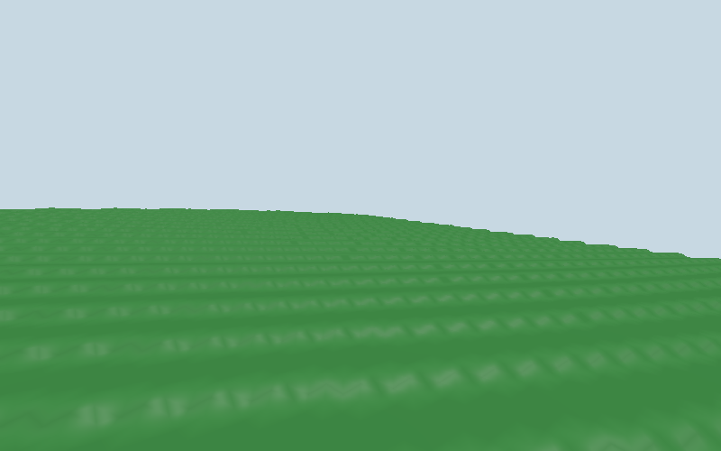
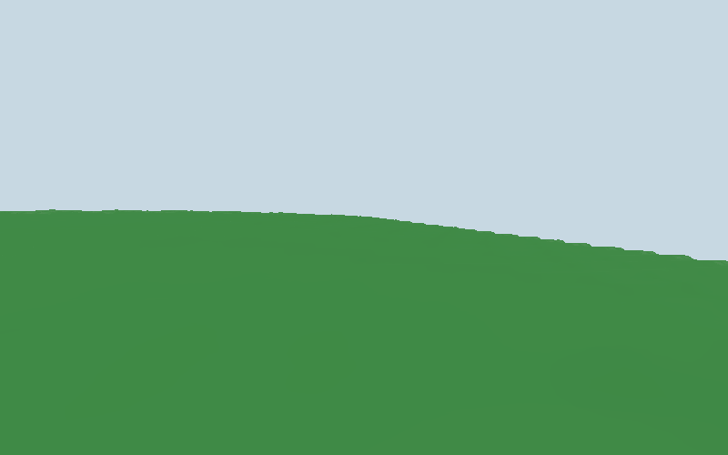
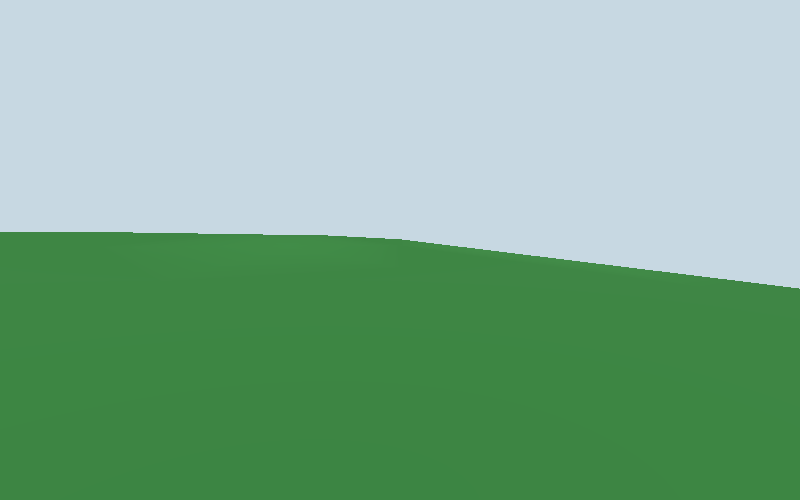
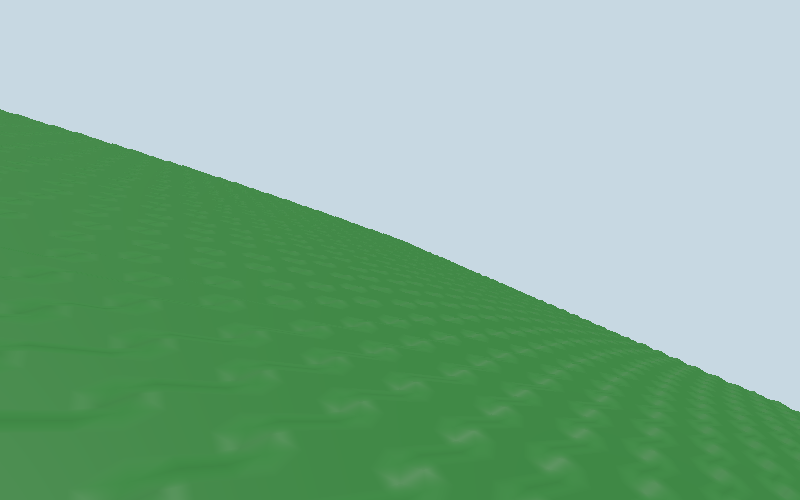
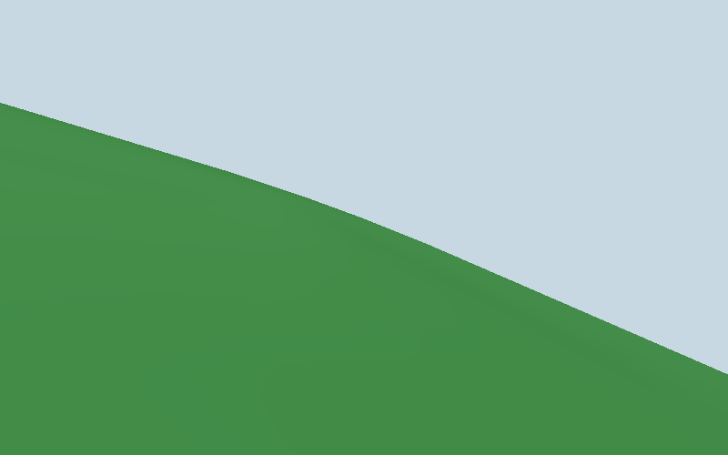
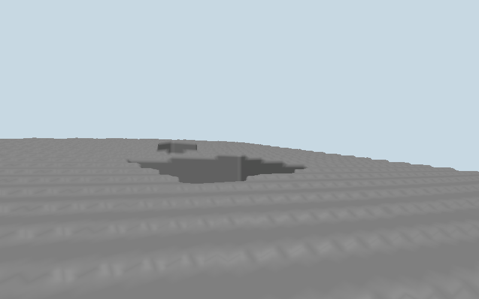
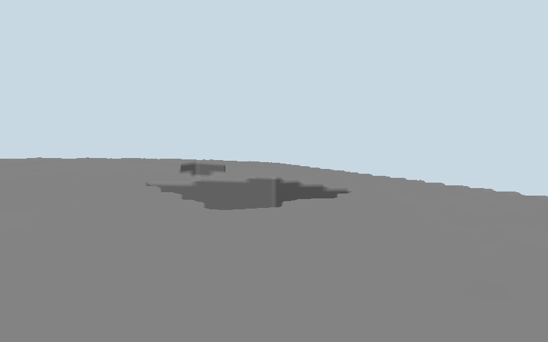
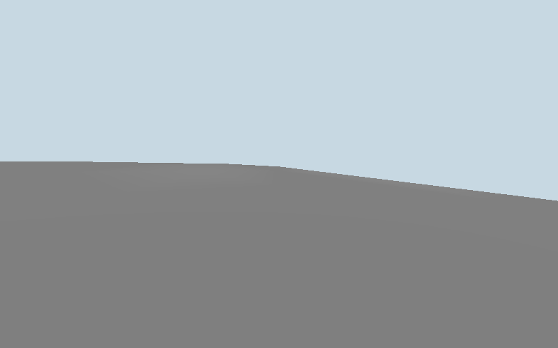

# Phase E3 — Polygonal terrain surface quality

## A. Root cause

The repeating near-ground bands primarily come from **binary occupancy normals**, rather than a grass texture or insufficient triangle count. `SurfaceNets.mjs` classifies the eight corners of each cell from quarter-meter composed occupancy. Its 256 precomputed patterns place a vertex at the average crossing-edge midpoint and derive its normal from differences between binary corner values. A gentle quantized slope repeatedly visits the same few patterns: the controlled hillside has only four distinct upward normal directions. Lighting makes those directions look like waves.

There is also real height quantization: the controlled near surface has about 13.6 cm RMS elevation error relative to the known analytic fixture. Improving normals does not remove that error or change the silhouette. The authoritative production height sampler itself is often quantized; this work does not invent continuous geographic elevations.

The distant `TerrainLOD/Heightfield.mjs` interpolates a much coarser mesh, using the authoritative height sampler and height-gradient normals. Its broad interpolation suppresses the conspicuous repeated shading. Near and distant terrain use the same canonical material definitions. The canonical grass material is a uniform green color (`#3f8f46`), with no grass texture responsible for the bands. Neutral lighting reproduces them; normal visualization exposes the limited directions. Unlit, flat-face-shaded and wireframe original/modified images are byte-identical. Shared chunk samples already agreed before this change: a chunk-normal seam was not the cause.

## B. Implementation

**Smooth natural ground** is a supported, optional normal-only correction. **Standard Surface Nets remains the default**, including documents without a new setting. The correction visibly improves slopes, but software-renderer timings show costs that prevent claiming a universally superior default.

- `TerrainRepresentation/GroundNormals.mjs` derives filtered gradients from the existing base terrain heights on a globally aligned 1 m grid with a 2 m gradient support. It interpolates those gradients at Surface Nets vertices during mesh preparation, never per frame.
- It changes only upward natural top-surface normals. All eight composed cell material/occupancy values must match the base source. Changed occupancy/materials, liquid, caves, unsupported/NoData neighborhoods, steep discontinuities and feature surfaces retain the original normals. It never changes vertices, triangle ownership, UVs, materials, collision or source elevations.
- `SurfaceNets.mjs` accepts an optional shading callback; omitting it preserves the original extraction and golden compatibility hashes. `CachedChunkBuilder.mjs` selects the callback only for `smooth-natural`; standard cache keys retain compatibility, and smooth entries use separate keys.
- `MeshCache.mjs` invalidates a nine-voxel horizontal source-normal halo and the existing one-voxel vertical occupancy halo. Runtime map updates include the same horizontal support. The existing 32 MiB / 128-entry LRU remains bounded; two styles share that budget.
- `GroundAppearance.mjs` coordinates style changes through `ChunkRepresentation.mjs`'s atomic replacement. Old meshes stay visible during preparation. Cancellation, failed history guards, disposal and simultaneous mode/style requests cannot commit mixed styles.
- `Representation.mjs`, `VoxelWorldDefinition.mjs`, `Authoring.mjs` and `Controls.mjs` validate and persist `polygonalGroundStyle`, integrate history/dirty state and expose a small select in the existing terrain controls. Viewer controls remain read-only. Unsupported legacy grid terrain does not display the setting.
- `ProceduralVoxelWorldRuntime.mjs` binds the selected style, cache builder and invalidation. Existing streaming, composed occupancy, material batching, vegetation submission, cache limits and collision pipelines remain in place.

The experimental quarter-meter heightfield was diagnostic only. It neither cures the quantized normal field by itself nor preserves the edited fixture's volumes. No hybrid renderer, duplicate ground mesh, extra production geometry or Phase E2 tree redesign was introduced.

## C. Actual rendered comparisons

[Open the comparison gallery](TerrainE3Visuals/index.html): 90 retained WebGL PNGs, three scenes × five representations × six diagnostic materials. The gallery includes original and modified near terrain, existing 2 m and 8 m heightfields, and a diagnostic 0.25 m heightfield. Each row uses identical source, camera, lighting, scale, viewport, colors and roughness. Heightfields in the edited scene intentionally demonstrate their inability to represent the cut and added block; they are not production replacements.

| Scene | Original near | Smooth near | Existing distant LOD 2 |
|---|---|---|---|
| Gentle hillside |  |  |  |
| Steep hillside |  |  |  |
| Authored cut and stone |  |  |  |

The smooth near surface loses the repeating light/dark bands and resembles the distant model landscape more closely. The excavation and stone remain sharp. Broader silhouettes, wireframe and flat shading are identical between the two near variants.

## D. Geometry and source fidelity

[Raw visual measurements](TerrainE3VisualMetrics.json) include all 15 meshes, preparation/frame times and rendered workload. Angular errors compare ordinary top vertices with the known analytic fixture gradient; they are not a claimed survey accuracy for real DEMs.

| Controlled near scene | Vertices / triangles, both styles | Mean normal error, standard → smooth | Mean edge normal jump | Height RMS, both |
|---|---:|---:|---:|---:|
| Gentle | 55,370 / 104,024 | 18.34° → 1.11° | 14.81° → 0.40° | 0.1362 m |
| Steep | 67,930 / 127,516 | 18.09° → 0.83° | 16.58° → 0.27° | 0.1327 m |
| Edited | 57,223 / 107,824 | 18.66° → 1.66° | 14.97° → 0.78° | 0.1371 m |

Gentle near buffer memory is exactly 2,395,984 bytes in either style. Its smooth normal field has 537 distinct sampled directions rather than four. The same gentle source at existing LOD 1 has 2,048 vertices / 1,024 triangles; LOD 2 has 320 / 160. The diagnostic 0.25 m heightfield has 16,641 / 32,768, yet retains about 13.53° mean normal error: density alone does not resolve the binary/quantized shading problem.

Positions, UVs, indices, canonical groups and occupancy counts are exactly equal in focused tests. Production benchmarks fingerprint installed geometry/material ownership with SHA-256 outside measured phases; all paired workloads must match. Duplicate chunk samples have zero component difference, including signed coordinates and an excavation crossing a chunk boundary. The normal support is global, not chunk-relative.

Volume and collision preservation follows from unchanged composed geometry, and is exercised by actual picking/collision tests for additions/removals and by the teleporter browser suite. Natural source fidelity is checked against actual procedural, infinite, finite map, hybrid and saved geographic generators. Water, cliffs, caves, tunnels, overhangs, cuts and material changes have explicit conservative fallback assertions. Path/construction and session edit changes still invalidate caches. Existing vegetation occupancy and distant instances are not repositioned or regenerated by the correction.

Existing LOD mesh readiness/handoff rules are unchanged. Matching normals improves perceived near/distant consistency, but this is not an exact C1 geometric join between different LODs: the original resolution-dependent silhouettes and heightfield approximation remain.

## E. Performance

Measurements use Chromium/SwiftShader at 640 × 480, pixel ratio 1, not the user's hardware. [Final production matrix](TerrainE3Performance.json): 24 cases / 12 before-and-after pairs, 60 warmup frames, 180 stationary frames and 90 each walking, running and backtracking. Movement advances by fixed 0.06 / 0.18 m per frame, rather than claiming real-time player speed. Large/infinite scenes with both distant layers enabled have three alternating-order pairs; controls/small/geographic have one pair. Each case has a fresh runtime, settles preparation queues, then fingerprints the actual installed buffers. Both layers off/on means distant terrain and distant vegetation together; detailed vegetation occupancy remains present. This matrix does not independently attribute each distant layer's cost.

**Stationary mean / p95 milliseconds, original → Smooth:**

| World / distant layers / trial | Mean ms | p95 ms | Draw calls | Submitted triangles |
|---|---:|---:|---:|---:|
| small / off / 1 | 16.65 → 16.64 | 17.0 → 16.9 | 12 | 15718 |
| small / both / 1 | 16.84 → 16.83 | 18.5 → 19.1 | 16 | 18860 |
| large / off / 1 | 16.65 → 16.65 | 16.9 → 16.9 | 12 | 15718 |
| large / both / 1 | 50.73 → 61.61 | 67.4 → 88.0 | 133 | 86306 |
| large / both / 2 | 59.04 → 56.92 | 76.2 → 70.2 | 133 | 86306 |
| large / both / 3 | 55.74 → 55.12 | 64.1 → 60.4 | 133 | 86306 |
| infinite / off / 1 | 16.57 → 16.64 | 17.1 → 17.4 | 12 | 15718 |
| infinite / both / 1 | 52.03 → 66.34 | 69.3 → 86.6 | 105 | 68386 |
| infinite / both / 2 | 61.10 → 66.99 | 88.1 → 134.1 | 105 | 68386 |
| infinite / both / 3 | 58.77 → 61.19 | 79.6 → 86.9 | 105 | 68386 |
| geographic / off / 1 | 16.65 → 16.65 | 17.1 → 17.0 | 10 | 22744 |
| geographic / both / 1 | 22.26 → 32.87 | 33.0 → 42.2 | 42 | 48704 |

**Movement mean / p95 milliseconds**, arithmetic average across repeated pairs for large/infinite both-layer cases; single pair for geographic. Raw per-trial phases remain in the JSON.

| World | Phase | Mean ms, original → Smooth | p95 ms, original → Smooth |
|---|---|---:|---:|
| large | walking | 61.89 → 56.64 | 80.9 → 67.0 |
| large | running | 64.72 → 64.33 | 81.2 → 79.3 |
| large | backtracking | 72.30 → 70.92 | 89.8 → 80.7 |
| infinite | walking | 62.92 → 63.89 | 77.1 → 82.2 |
| infinite | running | 67.56 → 65.83 | 83.2 → 83.9 |
| infinite | backtracking | 77.26 → 76.63 | 98.8 → 94.3 |
| geographic | walking | 31.47 → 41.02 | 42.0 → 74.5 |
| geographic | running | 32.03 → 35.61 | 46.7 → 66.3 |
| geographic | backtracking | 29.81 → 28.63 | 38.5 → 35.7 |

These measurements do **not** establish an FPS improvement. Stationary triangle counts, draw calls, geometry hashes and buffer bytes are exactly equal across every pair, while normals intentionally differ. The large-world lit regressions cannot be dismissed as benchmark noise. Standard remains the default because its geometry, normals and rendering workload are the original path; the correction is selected explicitly for its substantial visual benefit. The optional setting does not add a per-frame normal pass.

The [same-scene normal isolation](TerrainE3NormalIsolation.json) holds the settled runtime/camera/geometry/materials fixed and swaps only the normal attribute, without terrain updates: three alternating pairs per world for lit and unlit controls, 45 warmup + 180 measured frames each. Large-world lit means were 42.81 → 52.92, 62.56 → 67.44 and 55.19 → 57.60 ms (about 4–24% slower). Infinite lit pairs improved twice and were effectively level once; geographic results were mixed. An infinite **unlit** control swung 39.60 → 52.00 ms even though its shader does not use these normals. That control demonstrates large software-backend variability, but does not erase the repeated large-world lit slowdown. The short controlled edited-image run also slowed from 17.74 to 26.44 ms; gentle/steep were approximately 16.7–16.9 ms. All evidence is retained rather than selecting favorable trials.

**CPU extraction**, eight identical precomputed real chunks, one discarded warmup and six interleaved measured trials ([raw CPU results](TerrainE3CPU.json)):

| Source | Mean original → Smooth, all eight chunks | Added per chunk |
|---|---:|---:|
| procedural | 59.86 → 68.73 ms | 1.11 ms |
| infinite | 57.55 → 70.87 ms | 1.67 ms |
| geographic | 145.14 → 160.17 ms | 1.88 ms |

This is real additional uncached work, not a performance win. Source voxel checks use a lazy 34³ Uint16/Uint8 memo (~118 KB), a bounded 52² column lookup and a small gradient map per chunk build; scratch memory is released after preparation. Cache hits reuse the prepared normal buffers. This short movement route produced zero backtracking cache hits; it does not establish a cache-hit frame-time benefit. Cache reuse is demonstrated by the focused runtime and existing representation-switch tests. Style-aware variants share the original bounded LRU; toggling can evict entries earlier but cannot increase the configured memory ceiling. Occupancy is reused for style changes. No extra production vertices, index buffers, terrain layers or vegetation instances are introduced.

**Preparation and main thread:**

| World / layers / trial | Settled preparation ms, original → Smooth | Stationary update mean ms | Walking update mean ms |
|---|---:|---:|---:|
| small / off / 1 | 579 → 490 | 0.039 → 0.044 | 1.153 → 1.171 |
| small / both / 1 | 458 → 462 | 0.042 → 0.045 | 1.074 → 1.088 |
| large / off / 1 | 376 → 420 | 0.038 → 0.040 | 1.109 → 1.092 |
| large / both / 1 | 806 → 984 | 0.033 → 0.047 | 1.623 → 1.608 |
| large / both / 2 | 933 → 957 | 0.044 → 0.043 | 1.634 → 1.686 |
| large / both / 3 | 880 → 958 | 0.051 → 0.041 | 1.674 → 1.581 |
| infinite / off / 1 | 532 → 484 | 0.039 → 0.041 | 1.117 → 1.104 |
| infinite / both / 1 | 1548 → 1699 | 0.057 → 0.051 | 1.821 → 1.891 |
| infinite / both / 2 | 2018 → 1730 | 0.062 → 0.051 | 1.749 → 1.718 |
| infinite / both / 3 | 1582 → 1792 | 0.047 → 0.054 | 1.843 → 1.712 |
| geographic / off / 1 | 638 → 602 | 0.033 → 0.043 | 0.056 → 0.058 |
| geographic / both / 1 | 1706 → 2074 | 0.047 → 0.051 | 0.056 → 0.054 |

Preparation combines occupancy generation, extraction and distant queues, with warm source/JIT effects; the isolated CPU trials distinguish extraction overhead. All initial queues drained. JSON retains per-phase generation/meshing deltas, LOD planning/masking/coarse CPU time, vegetation preparation, submission time, completed elapsed-query samples, cache hits/misses/evictions and geometry bytes. Stationary main-thread updates are much smaller than frame intervals; adding normals cannot solve the remaining distant rendering deficit. Query samples are counted only on newly completed results, not repeated snapshots. Software elapsed queries are **not hardware GPU time**. GC and upload-byte figures are explicitly unmeasured.


## F. Regression tests and reproducibility

The final application code passed (see [validation record and source hashes](TerrainE3Validation.json)):

- `npm run test:metaworld`: **58 test files passed**, zero failures. New suites contain nine focused normal/geometry/source tests and six style/cache/history/transaction tests. Original Surface Nets compatibility hashes remain valid.
- `NV_TERRAIN_NATIVE=1 node scripts/test-vegetation-phase-c.mjs Notebook/test.html`: production GameView panel and render loop, inspector/View controls, standard/smooth selection, style undo/redo, voxel/polygonal switching, save and Viewer reopen. Installed Editor/Viewer attributes are independently regenerated from composed source and checked component by component. Standard changed zero normal components; Smooth changed 4,875 in the sampled terrain. Serialized source fidelity checks passed.
- `node scripts/test-world-extent.mjs`: actual extent controls, history, signed infinite streaming, collision/editing, linked excavation, paths, Editor save and Viewer reopen.
- `python scripts/test-terrain-maps-browser.py`: map/hybrid rendering, source updates, persistence and imported GOX/STL/glTF/GLB regression scenarios. This browser harness uses mocked workspace/UI services; it is not a complete manual map-authoring session.
- `node scripts/test-raycasting-teleporter.mjs`: actual GameView geographic coarse and detailed landings, both representations, trusted toolbar/controller input, readiness and pending cancellation.
- `node scripts/test-terrain-e3.mjs`: controlled WebGL renders and metrics; asserts exact original/modified image equality for geometry-only diagnostics.
- `node scripts/validate-terrain-e3.mjs`: retained artifact completeness, normal improvement, geometry/image identity, paired draw/triangle counts, bounded caches and protected Notebook checksum.

Reproduce performance sequentially, with no concurrent browser/test load:

```sh
node scripts/profile-terrain-e3-cpu.mjs
node scripts/test-terrain-e3-performance.mjs /tmp/e3-performance-fresh.json
node scripts/test-terrain-e3-performance.mjs /tmp/e3-isolation-fresh.json isolate
```

Use a **new output path** for a fresh run: the runners resume completed pairs in an existing output. The performance runner serves original modules recorded from commit `a76ffdfeac0704154c5a853141352408aaabfddf`, validates the [baseline snapshot/shared-source hashes](TerrainE3BaselineSources.json), and shares the exact Three.js module identity and materials. Baseline sources are materialized only in a temporary directory. The same-scene isolation data predates the optional UI control but measures the identical finalized normal algorithm, geometry and shaders; the final production matrix explicitly selects the saved Smooth style.

Browser tests use temporary Notebook copies. `Notebook/test.html` remains byte-identical, SHA-256 `75533dd604cbacc1de34bd42e1e3c5a5faeef5f4779b51c520a2e0c0edd81292`.

## G. User walkthrough

1. Open a world in **Editor**, select its generated terrain, and choose **Polygonal** in the existing terrain representation controls (View controls or the terrain inspector).
2. Choose **Polygonal ground style → Smooth natural ground**. Current terrain remains visible until the replacement is ready. Compare a naturally lit hillside, especially grazing light across a gentle slope.
3. Choose **Standard Surface Nets** to compare or retain the existing performance profile. The control is disabled while preparing, in voxel mode and in a read-only Viewer. Unsupported grid terrain hides it.
4. Save the world and reopen it. The selected style persists, including when opened in Viewer. Undo/redo restores the previous choice. Old documents open as Standard without adding a style field automatically.
5. Inspect cuts, cave walls, added blocks, material boundaries and vegetation: their composed geometry remains authoritative. Switching back to voxel mode uses the original voxel pipeline.

## H. Remaining work and acceptance limits

The visible repeating near-ground shading is reduced by a targeted, supported correction, with no increase in rendered geometry or buffer sizes. **A universally faster smooth default has not been established.** Standard remains the compatible default; Smooth is an explicit visual-quality tradeoff with measurable extraction cost and unresolved software-rendering regressions in some scenarios.

The original E1 distant-terrain steady-state deficit is not solved by changing normals. Large/infinite worlds still incur distant geometry/material/vegetation submission and rendering cost. This task does not claim 60 FPS on the user's hardware. Hardware GPU testing at the user's original resolution, with repeat trials and both styles, is needed before revisiting the default.

Quantized near-ground silhouette/height error, conservative fallback around caves/water/cliffs/edited cells, and original LOD silhouette transitions remain. Smooth-to-protected shading boundaries can still be visible; retaining true feature geometry takes priority. No transition skirts or hidden replacement surfaces were added. Geographic NoData behavior stays conservative.

The environment has no available `/dev/dri` hardware renderer. Chromium uses SwiftShader; elapsed rendering queries describe its software backend, not hardware GPU execution. GC pause time, actual driver upload bytes and a full hardware VR/manual visual walkthrough are unmeasured. Automated source/geometry assertions and browser integration do not replace every possible authored world inspection. Phase E2 vegetation geometry remains separate and unimplemented.
